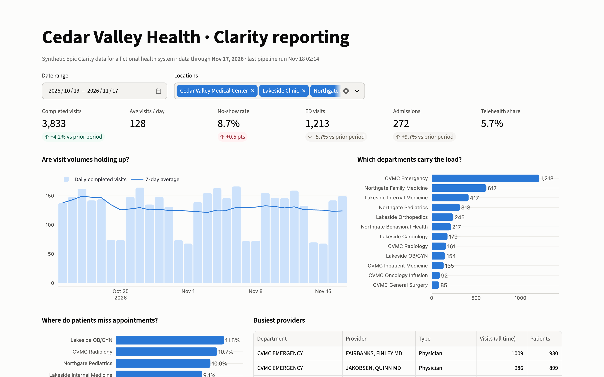
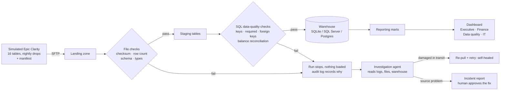
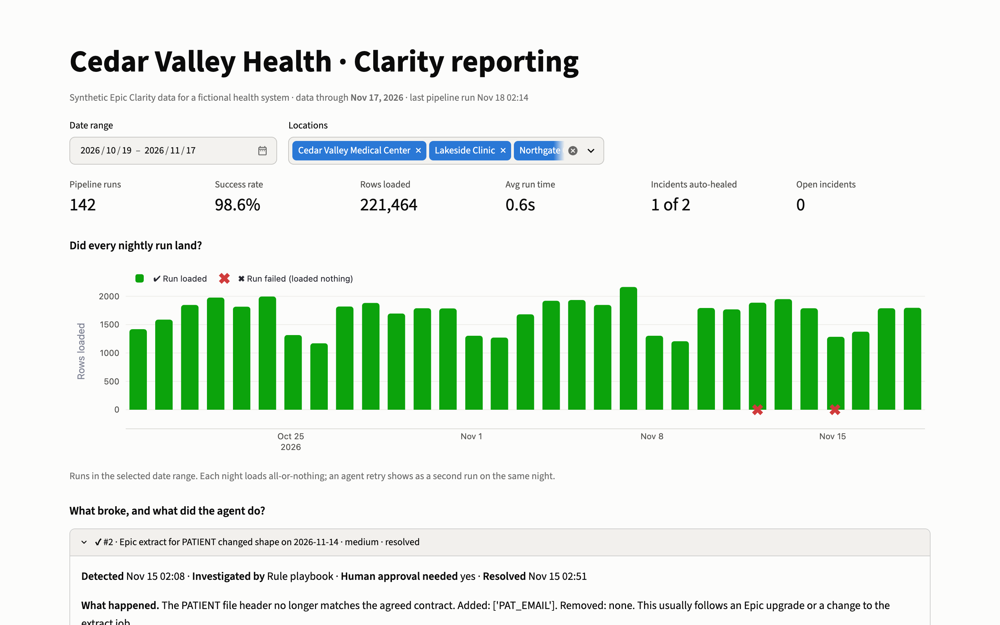
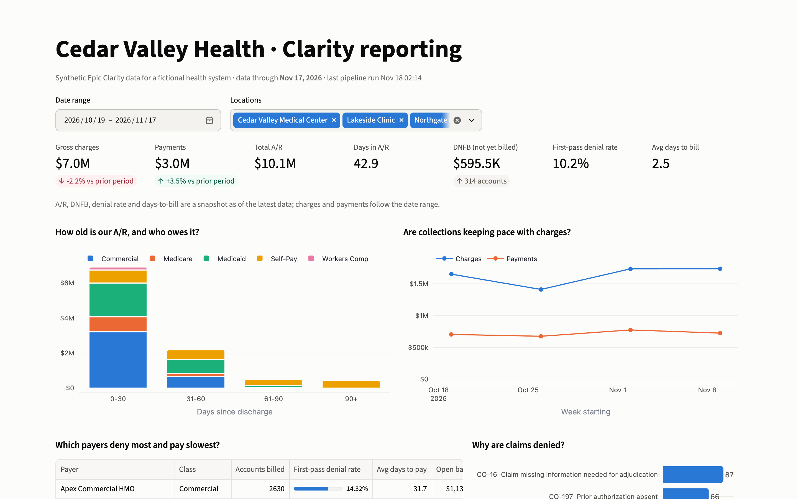
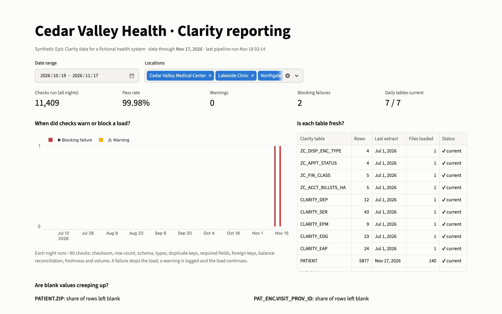

# Self-healing Epic Clarity ETL

An end-to-end pipeline that moves nightly **Epic Clarity** extracts into a SQL warehouse, checks every file and every
row before it lands, sends an **investigation agent** to diagnose any failure (and fix it on its own when the fix is
safe), and ends in one **dashboard for executive, finance, data and IT** audiences. Everything runs on a laptop in
under a minute and is tested in CI against a real **SQL Server** and **SFTP** server.

**Live dashboard:** [mudunuru-vaibhavi.github.io/clarity-agentic-etl](https://mudunuru-vaibhavi.github.io/clarity-agentic-etl/)
· **Portfolio:** [mudunuru-vaibhavi.github.io](https://mudunuru-vaibhavi.github.io/)

> All data is synthetic, generated for "Cedar Valley Health", a fictional health system. No real patient data (PHI)
> is used anywhere. ICD-10, CPT and denial (CARC) codes are public code numbers.



---

## Contents

1. [Results at a glance](#1-results-at-a-glance)
2. [Quick start](#2-quick-start)
3. [Architecture](#3-architecture)
4. [The concepts, explained](#4-the-concepts-explained)
5. [The agent in action](#5-the-agent-in-action)
6. [Questions the dashboard answers](#6-questions-the-dashboard-answers)
7. [CI/CD](#7-cicd)
8. [Repository layout](#8-repository-layout)
9. [Limitations and next steps](#9-limitations-and-next-steps)

---

## 1. Results at a glance

| | |
|---|---|
| Simulated source | 16 Clarity tables, 140 nightly drops: 12 departments, 43 providers, ~5,900 patients, 19,932 encounters, with charges, payments, denials and late charges |
| Checks per night | about 80: manifest, checksum, row count, schema contract, types, keys, foreign keys, balance reconciliation |
| Failures injected by the demo | 2 (a file truncated in transit; a new column added upstream) |
| Handled without a person | 1 of 2: the damaged file is re-pulled and reloaded in 4 minutes |
| Escalated for approval | 1 of 2: the new column looks like PHI, so the agent recommends a contract review instead of loading it |
| Reporting marts | 11, feeding a static dashboard with executive, finance, data-quality and IT views |
| Tests | 23 unit and integration tests, plus an end-to-end CI job on SQL Server 2022 and SFTP |

---

## 2. Quick start

You need Python 3.12+ and [uv](https://docs.astral.sh/uv/).

```bash
uv sync --extra dashboard
./scripts/demo.sh                        # simulate, load, break, investigate, build the dashboard
open site/index.html                     # the static dashboard (the same page GitHub Pages serves)
uv run streamlit run dashboard/app.py    # optional: the Streamlit version at http://localhost:8501
```

Individual commands:

```bash
uv run clarity-etl generate              # write nightly drops to data/sftp/outbox
uv run clarity-etl backfill --with-agent # load every night as a 2 AM run
uv run clarity-etl break schema_drift --date 2026-11-14
uv run clarity-etl run --with-agent      # one run; the agent investigates failures
uv run clarity-etl agent                 # investigate the latest failure
uv run clarity-etl status                # recent runs
uv run clarity-etl site                  # rebuild site/index.html from the warehouse
```

To point it at other systems, set environment variables:

- `CLARITY_ETL_DB_URL`: any SQLAlchemy URL, e.g. `mssql+pymssql://...` or `postgresql+psycopg://...`
- `CLARITY_ETL_SOURCE`: e.g. `sftp://user@host:22/outbox`, with `SFTP_PASSWORD`

---

## 3. Architecture



| Layer | What happens |
|---|---|
| **Source** | A day-by-day simulation of Clarity. Each night writes pipe-delimited files plus a manifest with row counts and SHA-256 checksums. Inpatient stays are re-sent at discharge, as real Clarity extracts do. |
| **Transfer** | Pulls new drops over SFTP (Paramiko), only once a drop's manifest exists, into a temporary folder that is renamed into place. |
| **Load** | Validates every file before touching the database, loads typed staging tables, runs SQL checks, then upserts into the warehouse. Each night is one transaction: all or nothing. A failed night holds every later night. |
| **Audit** | Every run, drop, file, check and incident is logged (`etl_run`, `etl_drop_log`, `etl_file_log`, `dq_result`, `etl_incident`). |
| **Agent** | Reads the audit log, inspects the files, profiles columns, queries the warehouse (read-only) and files a plain-English incident report. It may only **re-pull** a drop and **retry** the load. Schema changes and source fixes always need a person's approval. It flags new columns that look like PHI under HIPAA's minimum-necessary rule. |
| **Marts and dashboard** | pandas builds 11 reporting marts. `clarity-etl site` turns them into a single static HTML dashboard (Plotly, data embedded, light and dark mode, period and location filters). A Streamlit version runs locally for exploring. |

---

## 4. The concepts, explained

**Epic Clarity.** Epic's relational reporting database, refreshed nightly from the operational Chronicles database.
Health systems share it as table extracts. Its habits matter to an ETL: `_C` columns are category numbers decoded
through `ZC_` tables, encounters are keyed by `PAT_ENC_CSN_ID`, and hospital accounts (`HSP_ACCOUNT`) and their
transactions carry the money.

**Manifest-driven loading.** The source writes a manifest (file names, row counts, SHA-256 checksums) *last*. The
pipeline only picks up a drop whose manifest exists, and refuses any file that doesn't match it. A half-written or
corrupted file can never be loaded.

**Data contract (schema registry).** [`schema_registry.py`](src/clarity_etl/schema_registry.py) lists every expected
column, type, key and foreign key. A file that doesn't match is stopped before staging, so an upstream change (a new
column, a renamed one) becomes a reviewed decision instead of a silent break.

**All-or-nothing nightly loads.** Each night loads in one database transaction. If anything fails, nothing from that
night lands, and later nights wait, so the warehouse is never half-updated and the order of events is preserved.

**Safe automation.** The agent's actions are limited to the two that cannot damage data (re-pull, retry), and only on
evidence of damage in transit. Everything else becomes an incident report that a person approves. That boundary is what
makes it safe to let it act at 2 AM.

**Revenue-cycle metrics.** The finance view uses standard measures: days in A/R, A/R aging buckets, first-pass denial
rate, CARC denial reasons, DNFB (discharged, not final billed) and days to bill.

---

## 5. The agent in action

`scripts/demo.sh` replays 140 nights and breaks two of them on purpose:

| Night | What breaks | What the agent does | Outcome |
|---|---|---|---|
| Nov 11 | `HSP_TRANSACTIONS` file truncated in transit | Sees the checksum mismatch, re-pulls from SFTP, the fresh copy matches, retries the load | **Self-healed** in 4 minutes, no human needed |
| Nov 14 | Epic adds a `PAT_EMAIL` column to `PATIENT` | Compares the header to the contract and profiles the new column; flags it as likely PHI; recommends confirming with the Clarity team before adding it | **On hold for approval**. The Clarity team re-sends a clean file and the pipeline catches up by itself |

The tests also cover orphan records (a diagnosis pointing to a visit that doesn't exist) and bad values (`12O.50`
typed with a letter O). The agent follows a deterministic playbook per failure type
([`agent/runner.py`](src/clarity_etl/agent/runner.py)) and works only through the tools in
[`agent/tools.py`](src/clarity_etl/agent/tools.py), the same ones a person on call would use.



---

## 6. Questions the dashboard answers

| Audience | Questions |
|---|---|
| **Executive** | Are visit volumes holding up? Which departments carry the load? Where do patients miss appointments? ED visits, admissions, telehealth share, compared with the prior period |
| **Finance** | How old is our A/R, and who owes it? Are collections keeping pace with charges? Which payers deny most and pay slowest? Why are claims denied? Plus days in A/R, DNFB, first-pass denial rate and days to bill |
| **Data** | When did checks warn or block a load? Is each table fresh? Are blank values creeping up? |
| **IT** | Did every nightly run land? What broke, what did the agent do, and was a human needed? |




---

## 7. CI/CD

| Workflow | What it does |
|---|---|
| `ci.yml` | On every push: lint (ruff), 23 unit and integration tests, then an **end-to-end job** that pushes 3 weeks of drops to a real SFTP container, loads them into a real **SQL Server 2022** container, breaks one night, and checks that the agent heals it. |
| `cd.yml` | On merge to `main`, builds the pipeline Docker image and publishes it to GitHub Container Registry. |
| `nightly.yml` | Scheduled at 2:15 AM. Runs the pipeline and uploads the run report, incident reports and warehouse as build artifacts. |
| `pages.yml` | On every push to `main` and nightly: runs the pipeline, builds the static dashboard and publishes it to GitHub Pages. |

---

## 8. Repository layout

```
src/clarity_etl/
  source/             Clarity simulator, reference data, extract writer
  schema_registry.py  the extract contract: columns, types, keys, foreign keys
  transfer.py         SFTP and local transports
  validate.py         file checks (manifest, checksum, schema, types)
  loader.py           staging, SQL data-quality checks, upsert
  pipeline.py         one run, with audit logging
  warehouse.py        warehouse, staging and audit tables
  agent/              the agent's tools and its investigation playbook
  marts.py            reporting marts
  demo.py             break-it scenarios
  site.py, site_template.html   static dashboard for GitHub Pages
dashboard/app.py      Streamlit dashboard (local)
scripts/demo.sh       the full demo
tests/                unit, pipeline and agent tests
```

---

## 9. Limitations and next steps

This is a proof of concept:

- The Clarity tables are simplified (real Clarity has thousands of tables and columns).
- The marts are rebuilt in full after each run; production would build them incrementally.
- The dashboard is a static snapshot rebuilt after each run, not a live query.
- A production version would add secrets management, alerting (email or Teams) and role-based access to the dashboard.

**Tech:** Python · SQL · SQLAlchemy · pandas · Paramiko (SFTP) · SQL Server · SQLite · Streamlit · Plotly · pytest ·
ruff · Docker · GitHub Actions
